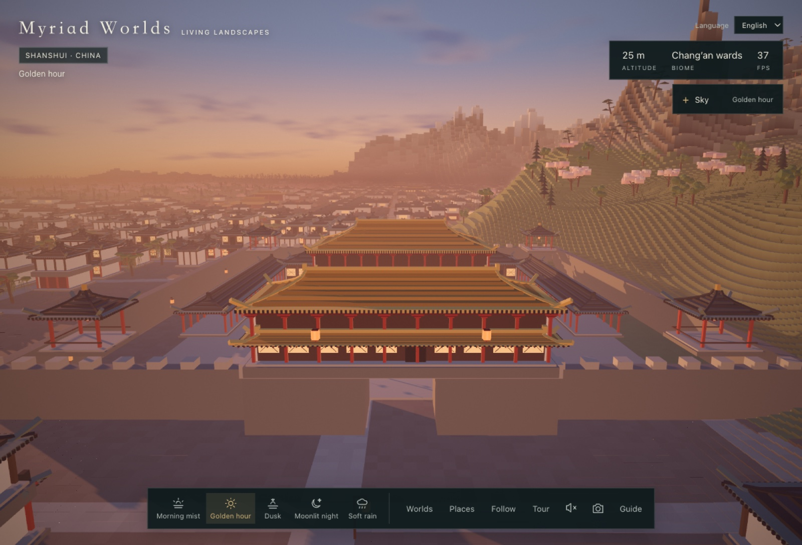
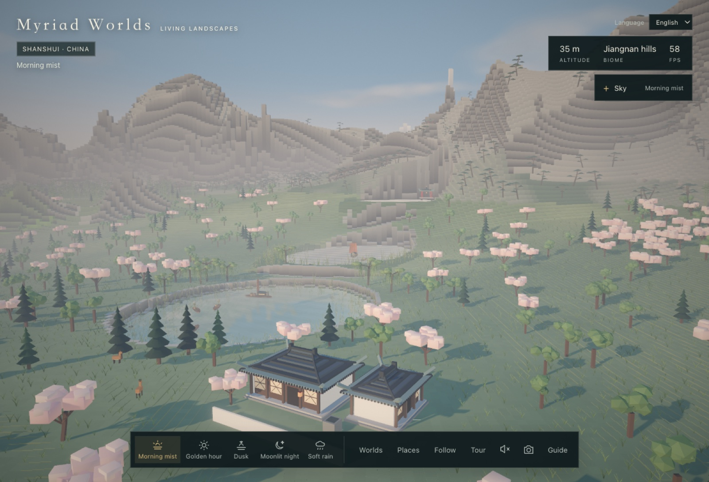
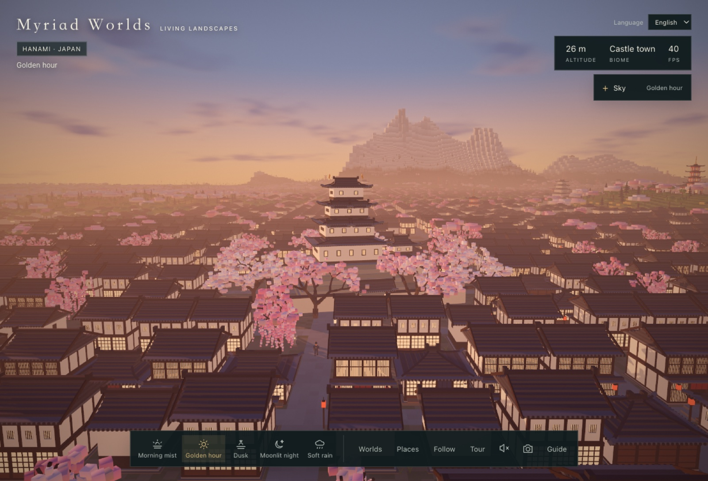
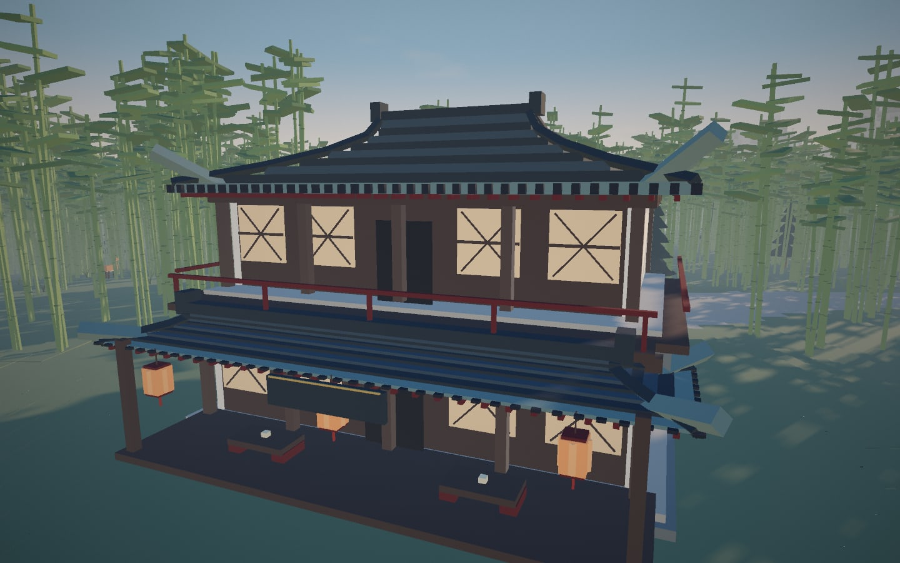
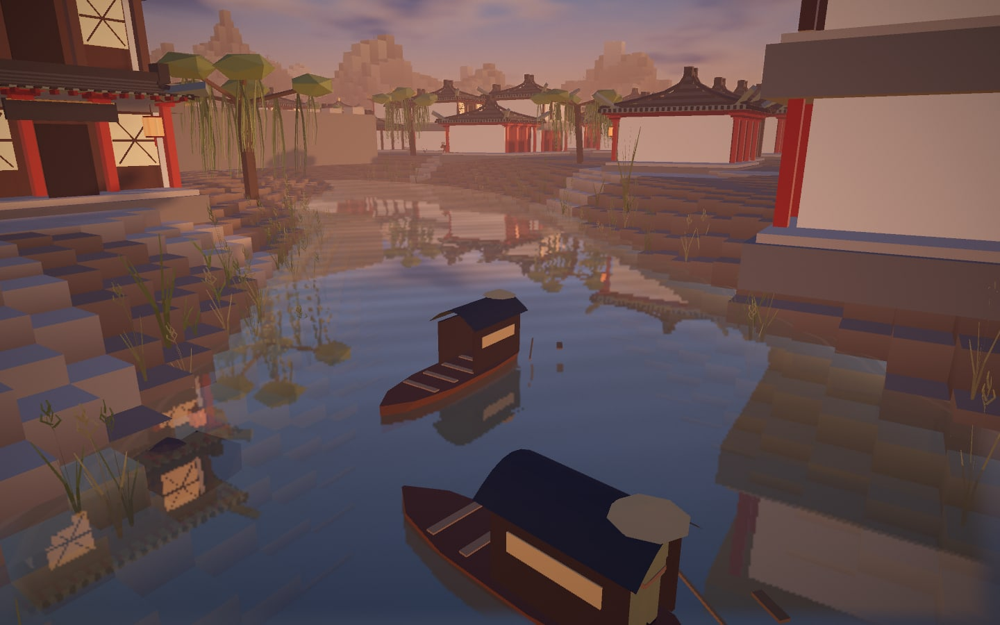

# Myriad Worlds · 万境

[中文](README.zh-CN.md) · [Explore online](https://myriad-worlds.pages.dev/)

Living, seed-generated landscapes in your browser. Wander on foot, fly above the clouds, or experience the world through the eyes of a train, crane, fish, resident or boat.

[](https://github.com/holooooo/myriad-worlds/raw/refs/heads/main/docs/media/myriad-worlds.mp4)

**[Watch the video · MP4](https://github.com/holooooo/myriad-worlds/raw/refs/heads/main/docs/media/myriad-worlds.mp4)** — recorded from the running world, with no pre-rendered scenery.

| World / 世界 | 16:9 | 9:16 |
| --- | --- | --- |
| Shanshui China / 山水中国 | [Landscape](https://github.com/holooooo/myriad-worlds/raw/refs/heads/main/docs/media/china-16x9.mp4) | [Portrait](https://github.com/holooooo/myriad-worlds/raw/refs/heads/main/docs/media/china-9x16.mp4) |
| Hanami Japan / 花见日本 | [Landscape](https://github.com/holooooo/myriad-worlds/raw/refs/heads/main/docs/media/japan-16x9.mp4) | [Portrait](https://github.com/holooooo/myriad-worlds/raw/refs/heads/main/docs/media/japan-9x16.mp4) |

The four scripted recordings demonstrate cinematic touring, time/weather transitions, smooth sky sliders and both train views. Reproduce them with [scripts/record_demos.py](scripts/record_demos.py) using Playwright CLI and ffmpeg.



## Two worlds, one engine

| Shanshui China | Hanami Japan |
| --- | --- |
| Granite needles, cliff pines and cloud seas | Blossom forests, bamboo groves and snow highlands |
| Contour rice terraces and descending mineral lakes | Rice paddies, coastal railway and lake shores |
| Chang’an wards, royal palaces and two-storey teahouses | Daimyo castles, shrines, mountain temples and tea houses |
| Cranes, buffalo, farmers, officials and merchants | Rice farmers, retainers, town merchants and ox carts |
| Horse carriages, sedan chairs, fishing boats and trading vessels | Kago palanquins, fishing boats and coastal traders |
| Dense sky lantern colonies after dusk | Lantern streets and quiet torii paths |




| Two-storey teahouse | Fishing boats and shore vegetation |
| --- | --- |
|  |  |

Dawn, golden hour, dusk, night and rain change lighting, water, mist and weather together. The compact **Sky** button opens separate foldable cloud, sun, star, moon and giant-planet controls. Continuous sliders adjust solar redshift, sun size/brightness, star count/density/brightness, lunar phase, moon size/halo/brightness with a separate dawn/dusk sun–moon coexistence toggle. The interface supports Chinese, Japanese and English, initially chosen from your browser language. Optional giant-planet skies include an icy ringed world, a Jupiter-like storm and a close white ringed planet, with separate size, direction, brightness and ring tilt controls, detailed surfaces and automatic rotation. Giant planets start disabled on every page entry; the close white planet has a smooth, unspotted surface.

German towns, Swiss alpine villages and Norwegian fjords are planned as a separate western fantasy profile; they are not part of this release.

## Explore

- Drag to look; scroll or pinch to move.
- `W A S D`: move · `Space / E`: rise · `Q`: descend · `Shift`: accelerate.
- **Worlds** changes the theme; **Places** selects destinations and world seeds.
- Click a moving unit or open **Follow**: kinds are grouped and sorted by distance. Trains start at the locomotive; switch to the side view to see the whole convoy. `Esc` exits.
- `T`: cinematic tour · `H`: hide the interface · `P`: save a PNG. Tours score terrain and foreground visibility, then use inspected static, orbit or pan paths. Only the upper-left identity remains visible; `1–5` changes time/weather and `Esc` ends the tour.
- Ambient audio is synthesised locally and starts only when enabled.

Direct links: [Shanshui](https://myriad-worlds.pages.dev/?theme=shanshui&seed=sakura) · [Hanami](https://myriad-worlds.pages.dev/?theme=sakura&seed=sakura). `q=high` or `q=lite` selects rendering quality. Matching theme and seed reproduce the same terrain and asset layout.

## Run and build

Requires Node.js 22+, Python 3.10+ and a WebGL 2 browser.

```sh
npm ci
npm run dev
# http://127.0.0.1:8765/
```

```sh
npm test
npm run build
python3 -m http.server 8765 --directory dist --bind 127.0.0.1
```

`build.py` assembles modules in `world.manifest.json`. A release build writes `dist/` and includes pinned Three.js 0.171.0 locally, so deployment does not rely on a runtime CDN. The quick development entry point uses the same version via importmap.

## Architecture and performance

- Theme profiles own deterministic terrain, habitats, palettes, landmarks and assets.
- Web Workers build chunks; parent chunks remain visible until their complete child coverage is ready.
- Near and distant assets share seeded locations, species and landmark footprints.
- Dense instance pools submit only visible assets; conservative view culling retains nearby shadows and mirrored scenery.
- Vegetation uses shared geometry and root-weighted wind. Petals, lanterns, wildlife and settlement actors have bounded pools.
- Lakes have separate elevations, water IDs and mineral tints. Reflection uses one bounded target for the nearest water level, with sky reflection on other levels.
- Land animals avoid water and city spawns. Residents follow streets, vehicles stay on roads, and boats validate water levels, shores, buildings and rail corridors.
- Rail corridors physically cut terrain and reserve structure clearance at every LOD.
- Access, business and error events use leveled logs; the in-memory diagnostic history is bounded.

See [validation and performance notes](docs/validation.md) for measured conditions and limits. Frame rate depends on viewport, GPU, terrain density and quality; 60 FPS is a target rather than a hardware-independent guarantee.

## Cloudflare deployment

The [GitHub Actions workflow](.github/workflows/cloudflare-pages.yml) runs regression checks, builds the vendored site and deploys successful `main` builds to Cloudflare Pages. Pull requests only verify the build.

Configure repository secrets:

- `CLOUDFLARE_ACCOUNT_ID`: the target account.
- `CLOUDFLARE_API_TOKEN`: an account-scoped token with **Cloudflare Pages Edit** permission.

Create the Pages project once, then deploy locally:

```sh
npx wrangler login
npx wrangler pages project create myriad-worlds --production-branch main
npm run build
npm run deploy
```

When deployment credentials are absent, the workflow verifies and archives the build, then skips deployment with a notice. Tokens, local credentials, build output and browser test recordings are excluded from Git.

## Landscape references

Lake shapes and colour relationships were studied from real photographs of [Jiuzhaigou / Shuzheng Lakes](https://en.wikipedia.org/wiki/Jiuzhaigou) and [Daocheng Yading / Milk Lake](https://en.wikipedia.org/wiki/Yading). Their lessons inform procedural valley basins, wooded dams and pale shallows. No photographs were copied into world assets; screenshots and videos here come from this project.
