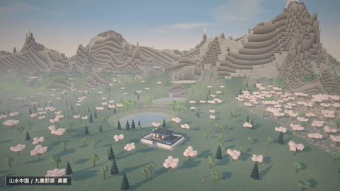

# 万境 · Myriad Worlds

[English](README.md) · [在线探索](https://myriad-worlds.pages.dev/)

在浏览器里探索由种子生成的山河、城镇与生物群落。步行、飞行，或将第一视角绑定到火车、仙鹤、鱼、居民和船只，随它们行游。

[](https://github.com/holooooo/myriad-worlds/actions/workflows/cloudflare-pages.yml)
[](https://myriad-worlds.pages.dev/)

**[打开在线世界 →](https://myriad-worlds.pages.dev/)**：WebGL 2 实时生成，无预渲染场景，无需账号或后端，内置中、日、英三种界面语言。

[](https://github.com/holooooo/myriad-worlds/raw/refs/heads/main/docs/media/scenery-tour.mp4)

**[观看 70 秒景色演示 · MP4](https://github.com/holooooo/myriad-worlds/raw/refs/heads/main/docs/media/scenery-tour.mp4)**：十段真实浏览器录屏，覆盖两种世界的彩湖、王宫、竹海、亭榭、灯市、山寺、樱林、湖畔、神社和城下町，以及晨雾、暮光、细雨、薄暮和月夜。

使用 [scripts/record_scenery.py](scripts/record_scenery.py)复录或自定义片单；[录屏指南](docs/recording.md)说明如何修改天气、景点、种子和竖屏格式。视频旁的 JSON 保留实机录制信息。下方截图也来自运行中的世界。


## 一套引擎，两方天地

| 山水中国 | 花见日本 |
| --- | --- |
| 黄山峰林、崖松与云海 | 樱花林、竹海与雪岭 |
| 依山等高线梯田、逐级下降的异色彩湖 | 棚田、海岸铁道与湖泊 |
| 长安街市、王宫御苑、双层茶楼 | 大名城堡、神社、山寺与茶屋 |
| 仙鹤、水牛、农民、官员、商人 | 稻农、侍臣、町人和牛车 |
| 马车、轿子、渔舟、商船 | 驾笼、和船与海上廻船 |
| 薄暮和月夜的密集孔明灯群 | 城下町灯火与林间鸟居 |


| 双层茶楼 | 渔舟与岸边植物 |
| --- | --- |
|  |  |

晨雾、暮光、薄暮、月夜、细雨共同改变光照、水面、雾气和天气。底部「天空」图标打开可独立折叠的云层、太阳、星空、月亮和巨行星控制。滑块连续调整太阳红移、太阳大小与亮度、星星数量/密度/亮度、月相、月亮大小/光晕/亮度，并可独立开关早晚日月同辉。界面支持中文、日文与英文，首次进入跟随浏览器语言，也可手动切换。还可以开启冰蓝星环、木星风暴、近地白色星环三种巨行星异象，独立调整大小、方位、仰角、亮度与星环倾角，表面带有细节并默认自转。每次进入页面时巨行星均关闭；近地白色星环的盘面采用平滑无斑点样式。

德国城镇、瑞士雪山村庄与挪威峡湾将作为独立西方奇幻主题扩展，目前尚未加入本版本。

## 操作

- 拖动环顾，滚轮或双指缩放前进、后退。
- `W A S D` 移动；`Space / E` 上升；`Q` 下降；`Shift` 加速。
- 「世界」切换主题；「寻境」选择景点或更换种子。
- 点击移动单位，或在「跟随」菜单按种类、距离选择；火车默认进入车头视角，可切换侧面第三视角看多节车厢。`Esc` 退出。
- `T` 开始巡游；`H` 隐藏界面；`P` 保存 PNG。巡游对地形、前景遮挡和构图评分，选择静态、环绕或平推路径，只保留左上角信息；`1–5` 切换时段天气，`Esc` 结束巡游。
- 环境音在本地合成，点击声音按钮后才播放。

直达：[山水中国](https://myriad-worlds.pages.dev/?theme=shanshui&seed=sakura) · [花见日本](https://myriad-worlds.pages.dev/?theme=sakura&seed=sakura)。`q=high` / `q=lite` 控制画质；相同主题和种子可复现地形、物种与资产布局。

## 本地运行与构建

需要 Node.js 22+、Python 3.10+ 和支持 WebGL 2 的浏览器。

```sh
npm ci
npm run dev
# 打开 http://127.0.0.1:8765/
```

```sh
npm test
npm run build
python3 -m http.server 8765 --directory dist --bind 127.0.0.1
```

`build.py` 按 `world.manifest.json` 组装模块。发布构建写入 `dist/`，并打包固定版本 Three.js 0.171.0，线上不依赖外部 CDN。开发入口使用同版本 importmap。

## 架构与性能

- 各主题独立管理地形、生态、材质、地标和资产规则。
- Worker 异步生成区块，子区块全部就绪后才替换父区块。
- 近远景共用资产坐标、物种、种子和建筑占地，降低细节时保留整体轮廓。
- 实例池压紧可见内容，隐藏区块不提交顶点；视野裁剪保留近处阴影与倒影范围。
- 植物共享几何，风动固定根部；花瓣、孔明灯、动物、居民和船只均有数量上限。
- 彩湖有独立水位、水体 ID 与水色；最近水位使用有界反射目标，其余使用天空反射。
- 陆生动物避水且不在城内刷新，居民和车辆沿路移动，船只校验岸线、水位、建筑与铁路。
- 铁路实际切开山坡，并在全部 LOD 中保留净空；建筑生成避让轨道。
- 访问、业务和错误日志分级记录，诊断历史有固定容量。

实测环境与限制见[验收和性能记录](docs/validation.md)。帧率受显卡、视口、资产密度与画质影响，60 FPS 是优化目标。

## Cloudflare 发布

[GitHub Actions 流水线](.github/workflows/cloudflare-pages.yml)对各分支与 PR 执行测试、构建、归档，再发布：

- `main` 更新正式站：**https://myriad-worlds.pages.dev/**。
- 其他分支生成隔离的 Cloudflare 预览；固定分支别名和本次部署链接显示在 Actions 运行摘要及 GitHub 环境中。
- 同仓库 PR 生成 `pr-<编号>` 预览，例如 `https://pr-12.myriad-worlds.pages.dev/`。外部 fork 的 PR 仅测试、构建，不会获得发布凭据。
- 也可在 **Actions → Verify and publish Myriad Worlds → Run workflow** 选择分支手动部署。

仓库 Secrets 为 `CLOUDFLARE_ACCOUNT_ID` 和仅具目标账户 **Cloudflare Pages Edit** 权限的 `CLOUDFLARE_API_TOKEN`。缺少凭据时仍执行测试与构建归档，明确提示并跳过发布。

现有 Pages 项目的生产分支为 `main`。新账户首次使用时，先执行 `npx wrangler pages project create myriad-worlds --production-branch main` 创建项目。本机发布：

```sh
npm ci
npx wrangler login
npm run deploy          # 先构建，再发布正式站（main）
npm run deploy:preview  # 先构建，再发布 preview.myriad-worlds.pages.dev
```

两个本地命令都会重新构建，并显式指定分支，避免本机 `master` 分支误选环境。预览链接公开可访问，请勿在其中发布隐私数据。凭据、token、构建目录和浏览器测试录屏均不提交到 Git。

## 致谢

参考[宝玉 @dotey 的提示词](https://x.com/dotey/status/2102565403109085669)，用 Opus 5.5 打底子，再由 GLM 5.3F 完成 Demo 开发。[X 发布文案](docs/x-post.txt)可配合实机景色视频使用。

## 实景参考

生成规则参考了[九寨沟树正群海](https://en.wikipedia.org/wiki/Jiuzhaigou)与[稻城亚丁牛奶海](https://en.wikipedia.org/wiki/Yading)的真实照片，提取沿谷湖盆、林岸堤坝、浅色湖底等地形与色彩关系。没有将参考照片复制为世界资产，文档截图和视频均为本项目实机画面。
